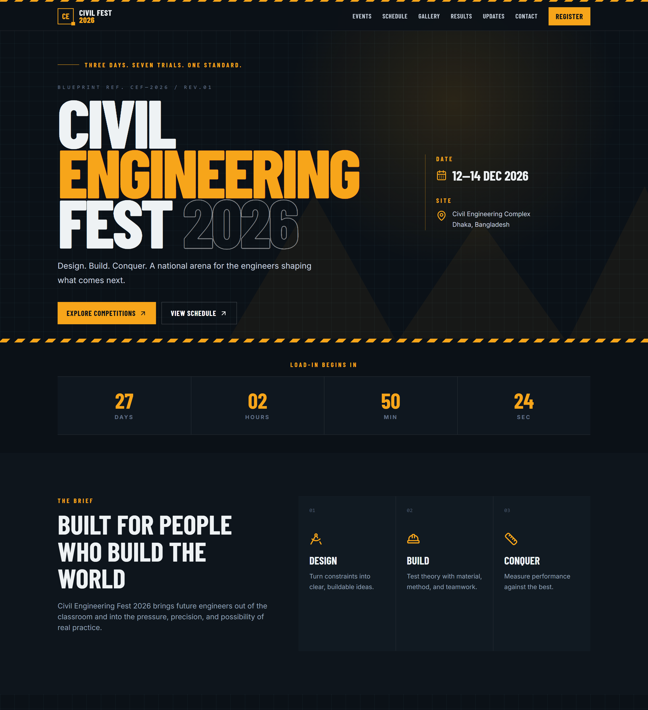

# ExCEEd

A modern, responsive event website for **ExCEEd 2026 - Civil & Environmental Engineering Fest**, designed to showcase the festival, its events, and key information through an engaging digital experience.

> **Design. Build. Conquer.**



**Live Demo:** [exceed-pi.vercel.app](https://exceed-pi.vercel.app/)

---

## Features

- Modern, event-focused landing page.
- Fully responsive design for desktop, tablet, and mobile devices.
- Multi-page architecture with client-side routing.
- Dedicated pages for different festival sections.
- Reusable and modular React components.
- Interactive navigation with responsive mobile menu.
- Data-driven UI for structured event content.
- Engaging hero sections and event-oriented layouts.
- Tailwind CSS utility-based styling.
- Lucide React icons for consistent visual elements.

---

## Tech Stack

- **Frontend:** React.js, JavaScript (JSX)
- **Styling:** Tailwind CSS
- **Routing:** React Router DOM
- **Build Tool:** Vite
- **Icons:** Lucide React
- **Deployment:** Vercel
- **Version Control:** Git & GitHub

---

## Getting Started

Follow these instructions to run the project locally.

### Prerequisites

- Node.js 20.19+ or 22.12+
- npm (Node Package Manager)

### Installation

Clone the repository:

```bash
git clone https://github.com/sasamir10/exceed.git
```

Navigate to the project directory:

```bash
cd exceed
```

Install dependencies:

```bash
npm ci
```

### Environment Variables

No environment variables are currently required to run the frontend application.

### Run Locally

Start the development server:

```bash
npm run dev
```

Open the application in your browser:

```text
http://localhost:5173/
```

### Production Build

Create an optimized production build:

```bash
npm run build
```

Preview the production build locally:

```bash
npm run preview
```

---

## Project Structure

```text
ExCEEd-React-project/
│
├── public/
│   └── ...                 # Static assets
│
├── src/
│   ├── components/
│   │   └── ...             # Reusable UI components
│   │
│   ├── data/
│   │   └── ...             # Structured application data
│   │
│   ├── pages/
│   │   └── ...             # Application pages
│   │
│   ├── routes/
│   │   └── ...             # Routing configuration
│   │
│   ├── App.jsx             # Root application component
│   ├── index.css           # Global styles
│   └── main.jsx            # Application entry point
│
├── index.html
├── package.json
├── package-lock.json
├── postcss.config.js
├── tailwind.config.js
├── vite.config.js
└── README.md
```

---

## Deployment

The application is deployed on **Vercel**.

To deploy your own instance:

1. Fork or clone this repository.
2. Import the repository into Vercel.
3. Set the framework preset to Vite.
4. Configure the build command as `npm run build`.
5. Set the output directory to `dist`.
6. Deploy the application.

**Live Website:** [https://exceed-pi.vercel.app/](https://exceed-pi.vercel.app/)

---

## Testing

Run the production build to check for compilation errors:

```bash
npm run build
```

Preview the production version:

```bash
npm run preview
```

The project does not currently define a separate automated test script.

---

## Behind the Architecture

**Sabbir Ahmed Samir**

- GitHub: [@sasamir10](https://github.com/sasamir10)
- LinkedIn: [Sabbir Ahmed Samir](https://linkedin.com/in/sabbirahmed10)
